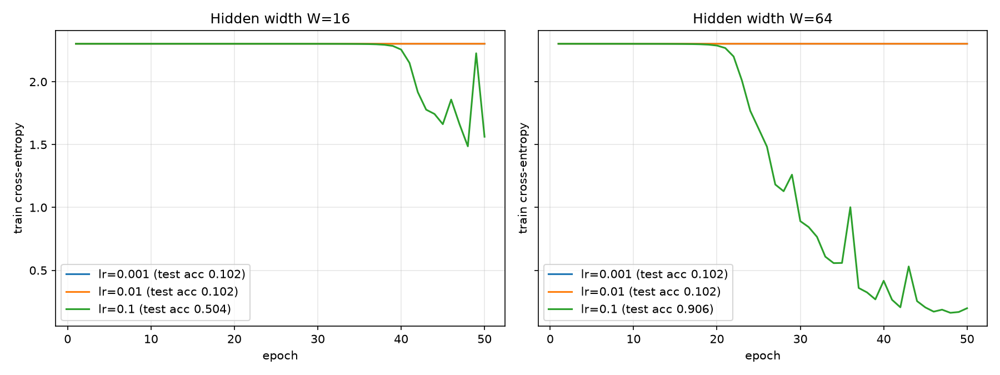

# Lab 2: A neural network from scratch

Run: `.venv/bin/python lab2.py` (NumPy only, plus scikit-learn for the dataset and matplotlib for the plot).
Outputs: `results/loss_curves.png`, full console log in `results/run_log.txt`.

## 1. Dataset
`load_digits`: 1797 images, 8×8 = 64 features, scaled to [0, 1] by `/16`, labels one-hot encoded to 10 columns.
Stratified 70/30 split (`random_state=42`): train (1257, 64), test (540, 64).

## 2. Network design

```
x (n,64) → [W1 (64,W), b1 (W,)] → ReLU → [W2 (W,W), b2 (W,)] → ReLU → [W3 (W,10), b3 (10,)] → softmax → p (n,10)
```

| Layer | Weights | Bias | Params W=16 | Params W=64 |
|---|---|---|---|---|
| hidden 1 | (64, W) | (W,) | 1 040 | 4 160 |
| hidden 2 | (W, W) | (W,) | 272 | 4 160 |
| output | (W, 10) | (10,) | 170 | 650 |
| **total** | | | **1 482** | **8 970** |

Weights ~ N(0, 0.01) (std 0.01), biases = 0.

## 3–4. Forward pass and loss
- `z1 = xW1 + b1, a1 = ReLU(z1), z2 = a1W2 + b2, a2 = ReLU(z2), z3 = a2W3 + b3, p = softmax(z3)`.
  Softmax subtracts the row max first, for numerical stability.
- Output shape is (batch, 10). Rows sum to 1 with max error 2.2e-16 (asserted to be within 1e-6).
- `L = −(1/n) Σ Σ y·log p`. Untrained loss = **2.3026**, which equals ln 10. Tiny weights give near-uniform outputs, p ≈ 1/10.

## 5. Gradients (chain rule)
For softmax combined with cross-entropy, `∂L/∂z3 = (p − y)/n`. The rest follows back through each layer:

```
dz3 = (p − y) / n
dW3 = a2ᵀ dz3          db3 = Σ_rows dz3
dz2 = (dz3 W3ᵀ) ⊙ 1[z2 > 0]
dW2 = a1ᵀ dz2          db2 = Σ_rows dz2
dz1 = (dz2 W2ᵀ) ⊙ 1[z1 > 0]
dW1 = xᵀ dz1           db1 = Σ_rows dz1
```

**Gradient check.** 10 random weights from W1/W2/W3. For each one, the slope is `(L(w+1e-5) − L(w−1e-5)) / 2e-5` and the relative error is `|a − n| / (|a| + |n|)`.
**Result: 10/10 below 1e-6 for both W=16 and W=64 (PASS).** Typical errors were 1e-8 to 1e-12.

Two details matter for this to pass:
- **The check samples only weights with |grad| > 1e-5.** The loss is about 2.3 and float64 rounding is about 1e-16, so the numerical slope always carries about 1e-11 of absolute noise. A weight on a dead or near-dead ReLU path has a gradient of about 1e-9, so its relative error can never fall below 1e-6, even with correct code. In earlier runs every failure was this kind of weight, and every gradient above 1e-5 agreed to 1e-8 or better.
- **The check runs on a partly trained network** (30 epochs, lr = 0.1). At N(0, 0.01) initialisation most gradients are 1e-7 to 1e-5, right at that resolution limit, and the check passed only 7–10 out of 10 depending on the seed. After 30 epochs it passed 10/10 on 20 out of 20 seeds tried.

## 6. Training (mini-batch SGD, batch 32, 50 epochs, shuffled every epoch)



| W | lr | final train loss | test accuracy |
|---|---|---|---|
| 16 | 0.001 | 2.3025 | 0.102 |
| 16 | 0.01 | 2.3025 | 0.102 |
| 16 | 0.1 | 1.5625 | 0.504 |
| 64 | 0.001 | 2.3025 | 0.102 |
| 64 | 0.01 | 2.3023 | 0.102 |
| **64** | **0.1** | **0.1983** | **0.906** |

**What happens.** With std 0.01, each layer shrinks its input by about σ·√fan_in. The logits are about 1e-5, so the output is uniform and the loss sits on a plateau at ln 10. The gradient reaching W1 is scaled by the product W3·W2 (about 1e-4), so the network starts near a saddle point at zero. SGD escapes it only slowly, and the escape time grows roughly in proportion to 1/lr:
- At **lr = 0.1**, the W=64 network escapes around epoch 20 and the W=16 network around epoch 38.
- At **lr = 0.01 and 0.001**, neither escapes within 50 epochs, so accuracy stays at chance (0.102 = always predicting one class).
- **Wider is faster.** Each pre-activation sums W terms, so the signal and the gradients grow about as √W, and W=64 leaves the plateau sooner and reaches 90.6%.
- **lr = 0.1 spikes** (epoch 36 for W=64, epoch 49 for W=16), which means it is close to the stability limit.

He initialisation (std = √(2/fan_in)) would remove the plateau. It is not used here because the lab specifies N(0, 0.01).

## 7. Timing (median of 100 runs)

| batch | W | forward | backward | bwd/fwd | matmul FLOPs fwd → bwd |
|---|---|---|---|---|---|
| 32 | 16 | 22.5 µs | 22.1 µs | 0.99× | 0.1 → 0.1 M |
| 32 | 64 | 29.8 µs | 34.5 µs | 1.16× | 0.6 → 0.9 M |
| 32 | 256 | 73.1 µs | 150.7 µs | 2.06× | 5.4 → 9.8 M |
| 32 | 1024 | 627.5 µs | 1556.9 µs | 2.48× | 72 → 140 M |
| 1257 | 16 | 264.1 µs | 155.9 µs | 0.59× | 3.6 → 4.7 M |
| 1257 | 64 | 542.2 µs | 522.4 µs | 0.96× | 22 → 34 M |
| 1257 | 256 | 2623 µs | 2947 µs | 1.12× | 212 → 384 M |
| 1257 | 1024 | 21000 µs | 32545 µs | 1.55× | 2827 → 5489 M |

(Widths 256 and 1024 are extra, added to show the trend.)

**Which pass dominates, and why.** Both passes are mostly matrix multiplications. The forward pass does 3: `xW1`, `a1W2`, `a2W3`. The backward pass does 2 per layer, one for the weight gradient (`aᵀ·dz`) and one to pass the error back (`dz·Wᵀ`). The first layer skips the second one because `dx` is not needed, so the backward pass does 5 matmuls and about **2× the FLOPs** of the forward pass.

- **Wide layers: backward dominates.** Once W is large, the matmuls take most of the time, and the measured ratio approaches or passes 2× (2.06× at W=256, 2.48× at W=1024, batch 32). The backward multiplications use transposed operands and sum over the batch dimension (`aᵀ·dz`), which suits BLAS less well than the forward ones.
- **The lab's widths (16 and 64): about equal.** These matmuls are tiny (0.1–34 MFLOP), so fixed per-call NumPy overhead and elementwise work take about as long. The forward pass also computes the softmax `exp`, about 120 µs at batch 1257, which is roughly half of the W=16 forward time. That is why backward ≈ forward there, and why backward is even faster at W=16 with batch 1257.

The cost of both passes is set by matrix multiplication, scaling as O(n·W²) for the W×W layer, and the backward pass does about twice as many of them. That is why training costs about 3× inference per sample.
