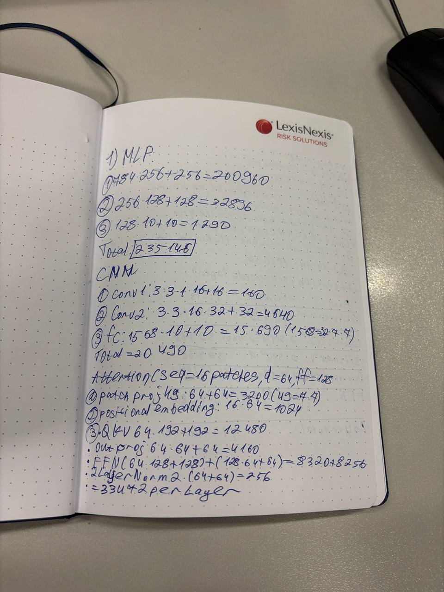
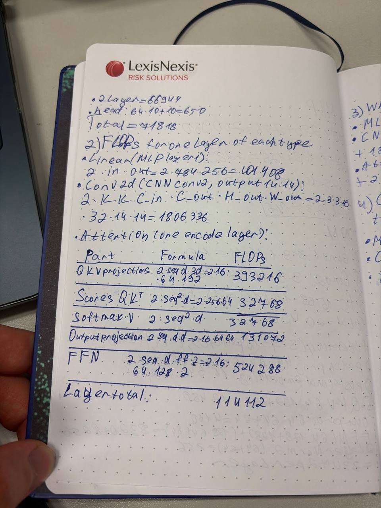
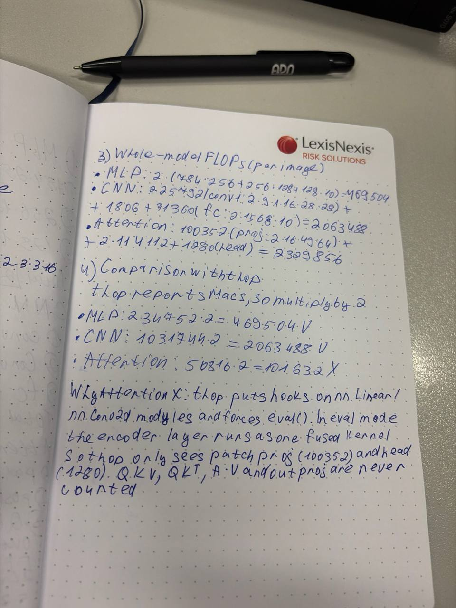
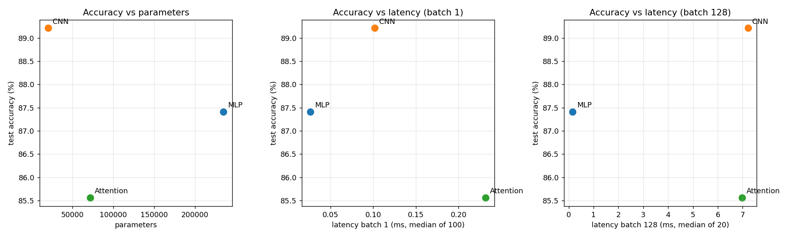

# Lab 3: Architectures and their costs

Run: `../.venv/bin/python lab3.py` (about 4 min on CPU). Outputs: `results/run_log.txt` (full console log, torchinfo summaries),
`results/results.json`, `results/tradeoff.png`.
Environment: Apple M3, macOS 15.7, Python 3.12, torch 2.3.1, CPU only, `torch.set_num_threads(4)`, seed 0.

## 1. Dataset
`torchvision.datasets.FashionMNIST`, `ToTensor()` + `Normalize((0.2860,), (0.3530,))`.
Official train 60k split with `random_split` (seed 0) into **55 000 train / 5 000 validation**. Official **10 000 test**. Batch size 128.

## 2. Models

| Model | Architecture | Params (torchinfo) |
|---|---|---|
| MLP | Flatten 784 → Linear 256 → ReLU → Linear 128 → ReLU → Linear 10 | **235 146** |
| CNN | Conv(1,16,3,p1) → ReLU → MaxPool2 → Conv(16,32,3,p1) → ReLU → MaxPool2 → Flatten → Linear(1568,10) | **20 490** |
| Attention | 16 patches of 7×7 → Linear 49→64 (+ learned pos. emb.) → 2× TransformerEncoderLayer(d=64, h=4, ff=128) → mean pool → Linear 64→10 | **71 818** |

Hand count, which matches torchinfo exactly:
- MLP: (784·256+256) + (256·128+128) + (128·10+10) = 200 960 + 32 896 + 1 290 = 235 146
- CNN: (9·1·16+16) + (9·16·32+32) + (1568·10+10) = 160 + 4 640 + 15 690 = 20 490
- Attention: proj 3 200 + pos 1 024 + 2 × [QKV 12 480 + out 4 160 + FFN 8 320 + 8 256 + 2 LayerNorm 256 = 33 472] + head 650 = 71 818

Parameter target: The layer specs in the manual don't produce models in that range: MLP is 1.6× above it,
CNN 5× below, Attention ~1.4× below. I kept the specified architectures rather than resizing them, so "similar size"
doesn't hold. Parameter count is therefore one of the variables being compared, not a controlled one.

Positional embedding: The spec doesn't mention one. Without it, the encoder plus mean pooling is
permutation-invariant over patches, so the model can't tell where on the image a patch came from. I added a learned
`(1,16,64)` positional embedding (+1 024 params, 0 FLOPs counted). Without it the model has 70 794 params.

## 3. Compute cost

### 3.1 Hand FLOPs, one layer of each type (per image, 1 MAC = 2 FLOPs)

**Linear** (MLP layer 1): `2·in·out = 2·784·256 =` **401 408**

**Conv2d** (CNN conv2, output 14×14): `2·K·K·C_in·C_out·H_out·W_out = 2·3·3·16·32·14·14 =` **1 806 336**

**Attention encoder layer** (seq = 16, d_model = 64, ff = 128):

| Part | Formula | FLOPs |
|---|---|---|
| QKV projections | 2·seq·d·3d = 2·16·64·192 | 393 216 |
| Scores QKᵀ | 2·seq²·d = 2·256·64 | 32 768 |
| softmax(·)·V | 2·seq²·d | 32 768 |
| Output projection | 2·seq·d·d | 131 072 |
| FFN | 2·seq·d·ff + 2·seq·ff·d | 524 288 |
| **Layer total** | | **1 114 112** |

Bias adds, ReLU, softmax, LayerNorm and pooling are not counted. They are O(activations), not O(weights).

Hand calculations on paper (parameters, one-layer FLOPs, whole-model FLOPs, thop comparison):

  

### 3.2 Whole model: hand vs measured

| Model | Hand FLOPs | thop MACs ×2 (default) | thop ×2 (MHA fast path off) | `FlopCounterMode` |
|---|---|---|---|---|
| MLP | 469 504 | 469 504 | 469 504 | 469 504 |
| CNN | 2 063 488 | 2 063 488 | 2 063 488 | 2 063 488 |
| Attention | 2 329 856 | **101 632** | **1 182 976** | 2 329 856 |

CNN total = conv1 225 792 + conv2 1 806 336 + fc 31 360.
Attention total = patch proj 100 352 (2·16·49·64) + 2 × 1 114 112 + head 1 280.

`torch.utils.flop_counter.FlopCounterMode` counts at the aten-op level (every `mm`/`addmm`/`bmm`/`conv`). It matches the
hand count exactly for all three models, so the hand formulas are correct.

**Explaining the gaps:**
1. **thop reports MACs, not FLOPs.** Its raw numbers are half of ours (MLP 234 752, CNN 1 031 744). After ×2 the MLP
   and CNN match exactly.
2. **thop misses almost all of the transformer (101 632 vs 2 329 856, 4.4% of the work).** thop works by putting forward
   hooks on leaf modules (`nn.Linear`, `nn.Conv2d`, …), and `thop.profile` puts the model in `eval()` itself. In eval
   mode, `nn.TransformerEncoderLayer` takes PyTorch's *fast path*: the whole layer runs as one fused
   `_transformer_encoder_layer_fwd` kernel, and none of its child modules' `forward` is ever called. Only the
   patch projection (100 352) and the head (1 280) are counted.
3. **With the fast path disabled** (`torch.backends.mha.set_fastpath_enabled(False)`), thop sees 1 182 976, still
   ~half. FFN `linear1`/`linear2` are now counted. Everything inside `nn.MultiheadAttention` is still missed: thop has no
   rule for it, and the QKV projection uses a raw `in_proj_weight` Parameter (not an `nn.Linear`) inside
   `F.multi_head_attention_forward`, together with the QKᵀ, A·V matmuls and `out_proj`.
   Reconciliation: hand 2 329 856 − missed 2 × (393 216 + 32 768 + 32 768 + 131 072) = 1 150 208, plus thop's LayerNorm
   estimate 4 × 8 192 = 32 768 → **1 182 976**, exact.

So module-hook profilers are reliable for plain Linear/Conv stacks and silently wrong for attention.
Use an op-level counter (`FlopCounterMode`) or the hand formula there.

### 3.3 Inference latency (CPU, `torch.inference_mode`, 10 warm-up runs, then median)

| Model | Batch 1, median of 100 | Batch 128, median of 20 | Per image @128 |
|---|---|---|---|
| MLP | 0.027 ms | 0.16 ms | 1.3 µs |
| CNN | 0.102 ms | 7.21 ms | 56 µs |
| Attention | 0.232 ms | 6.97 ms | 54 µs |

## 4. Training (Adam, lr 1e-3, batch 128, 5 epochs)

| Model | Val acc, epoch 1→5 | **Test acc** |
|---|---|---|
| MLP | 85.8 → 86.8 → 87.4 → 88.1 → 87.8 % | **87.41 %** |
| CNN | 87.1 → 87.4 → 89.6 → 89.7 → 90.2 % | **89.21 %** |
| Attention | 81.3 → 83.9 → 85.3 → 86.1 → 86.4 % | **85.56 %** |

Across two full runs, test accuracy moved by ≤0.3 pp. Latency moved by ≤0.03 ms at batch 1 and ≤0.3 ms at batch 128.
The ranking didn't change.

## 5. Trade-offs

**FLOPs don't predict latency.** At batch 128 the CNN does 4.4× the MLP's FLOPs but is **45× slower**. Attention does
5× the MLP's FLOPs and is 44× slower. The difference comes from memory-access patterns (Ch. 4.6–4.7):

- **MLP: dense GEMM, best data reuse.** With batch 128, each layer is one `(128×784)·(784×256)` matrix multiply. Each
  weight is loaded once and reused across all 128 rows. Arithmetic intensity is high, and the whole model (0.94 MB fp32)
  fits in the M3's cache. BLAS/AMX run this near peak. The weights are big, but they are read in a contiguous,
  predictable stream.
- **CNN: few weights, lots of activation traffic.** Its 20k weights are reused at every spatial position. That is
  exactly why it has 11× fewer parameters but more FLOPs than the MLP. But the activations are large: 16×28×28 floats
  per image after conv1, about 50 KB, so 6.4 MB per batch of 128. They must be written, re-read with a 3×3 sliding
  window (im2col expands the input ~9×), pooled and written again. With tiny channel counts (C_in = 1, 16), each loaded
  value does little math, so the conv layers are memory-bound, not compute-bound. The CPU spends its time moving
  feature maps, not multiplying.
- **Attention: many small ops plus a dynamic access pattern.** seq = 16 and d = 64 split the work into many small
  matmuls (per-head 16×16 scores), softmax and LayerNorm. These are memory-bound element-wise passes over the
  activations. The QKᵀ·V pattern is data-dependent: the attention weights are computed at run time, not fixed weights.
  At batch 1, fixed per-op overhead dominates (0.23 ms, 9× the MLP). The seq² term is small here (65k of 1.1M FLOPs per
  layer), so attention's quadratic cost isn't what makes it slow at this size.

**Which is most cost-effective?**
- Per parameter the CNN is best: the best accuracy (89.2%) with the fewest parameters (20k, 82 KB).
  Weight sharing is the right inductive bias for images: locality and translation equivariance. Choose it when
  memory or storage is the constraint (microcontrollers, model download size).
- Per unit of latency on this CPU the MLP is best: 87.4% at 1.3 µs per image, 43× cheaper than the CNN for −1.8 pp.
  This is because its access pattern (one big GEMM per layer) suits the hardware, not because it does less math.
  Choose it for throughput-bound CPU serving.
- Attention loses on every axis: lower accuracy than both and slower than both at batch 1. It also has 3.5× the CNN's
  parameters. With 16 tokens and 5 epochs it lacks the CNN's built-in locality prior, and 55k images are too few to
  learn that prior from data. Its strengths (global context, scaling with data and sequence length) aren't exercised
  by 28×28 Fashion-MNIST.

Overall, the CNN is the most cost-effective architecture for this task, with the best accuracy per parameter and
per FLOP. On a commodity CPU, the MLP has the best accuracy per millisecond. The CNN's latency gap comes from memory
traffic, which a GPU or a conv-optimised accelerator would largely remove; the MLP's parameter cost would not shrink.

## 6. Files
- `lab3.py`: everything (data, models, hand FLOPs, torchinfo, thop, FlopCounterMode, latency, training, plots)
- `results/run_log.txt`, `results/results.json`, `results/tradeoff.png`
